# JIRSN Forge

**Manufacturing operations software that answers one question honestly: can this work actually happen — with the people,
machines, materials, qualifications and safety conditions available, at the time it is needed?**

Forge is a full MRP / MES / QMS platform for a manufacturing plant: from quote to cash, from engineering release to the shop
floor, from supplier receipt to customer shipment, with the workforce, training and safety rules that real plants run on.
It is built to be audited: every change records who made it and why, approvals need a second person, and a number Forge
cannot measure is shown as *not yet measured*, never guessed.

> **Status:** v1.0.0 — installable on a Windows plant server. Sample data: *WhiskerWorks*, a fictional maker of giant cat toys.
> All rights reserved — see [LICENSE](LICENSE).

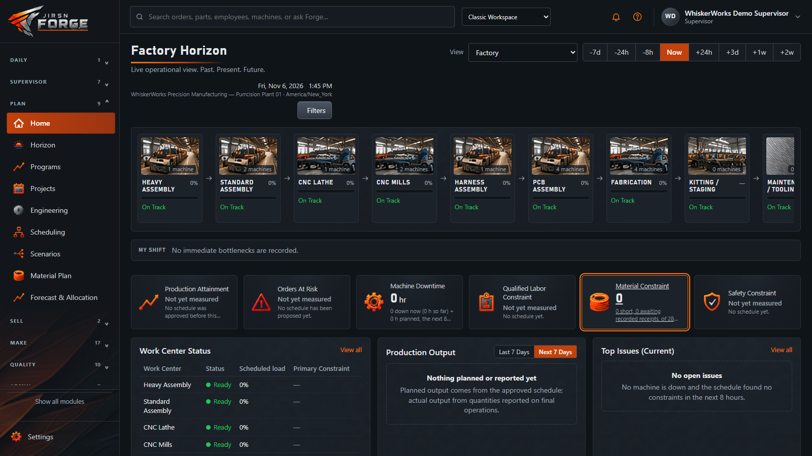

**[Watch the 2-minute tour](docs/media/forge-tour.mp4)** — a click-through of the WhiskerWorks sample plant.

---

## What it does

| Area | Highlights |
| --- | --- |
| **Plan** | MRP with pegging, finite-capacity scheduling with binding constraints, drop-dead dates, demand forecasting (trend, seasonal, sparse, families and options, new items), V5 material allocation optimizer (free stock, leftover pieces by size, unpegged work in progress, approved alternates), Risk Radar |
| **Make** | Production orders with release by a second person, operator kiosk with badge sign-in, labor and production reporting, backflush, rework, partial builds, WIP storage, amendments to released orders |
| **Quality** | Inspection plans, NCRs, CAPA, first-article inspection, SPC with signal alerts, gauges and calibration, supplier scorecards, trace investigations, product acceptance |
| **Materials** | Inventory by lot and serial, reservations, shelf life, cycle counts, receiving and inspection, remnants, purchasing with three-way match, shipping with UPS / FedEx / USPS / multi-carrier / LTL connectors |
| **Sell & bill** | Customers, quotes, sales orders with approval limits, credit holds, invoices, customer payments, promise dates, accounting export |
| **People** | Qualifications and certification (never by yourself), training queue and new-hire checklists, safety staffing rules (e.g. two-person coverage), attendance, DCAA-style timesheets, reviews |
| **Machines** | Machine readiness, maintenance and outages, OEE per shift, pluggable connectors (OPC UA and others) |
| **Trust** | Hash-chained audit trail, separation of duties, program access and data markings, step-up sign-in for sensitive approvals, ANSI X12 EDI and signed webhooks |

## Screenshots

| | |
| --- | --- |
| 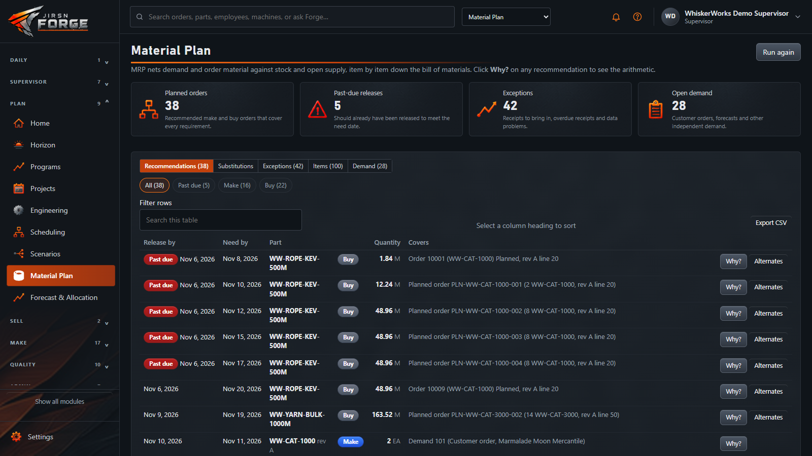 **Material plan** — MRP recommendations, each with a *Why?* | 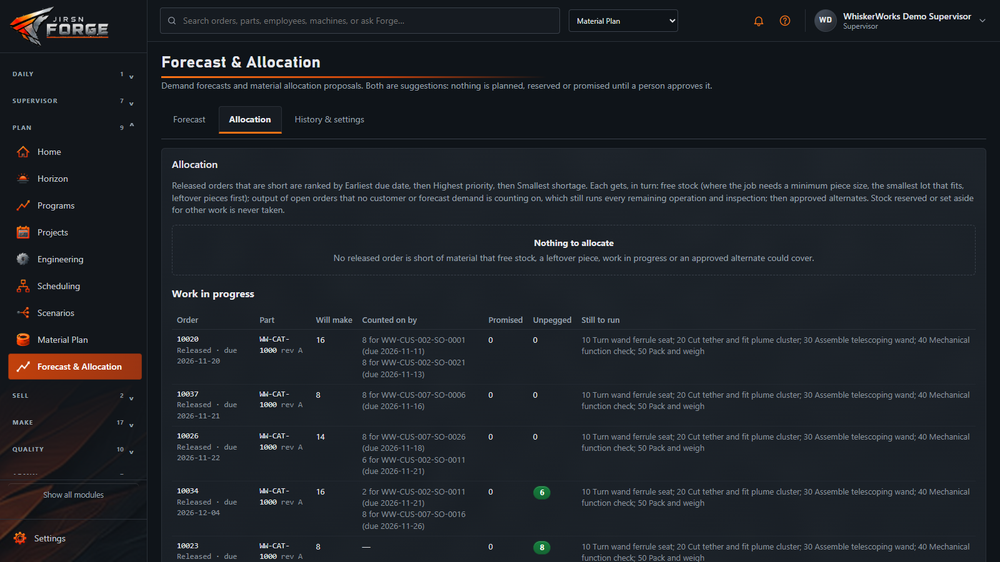 **Allocation** — free stock, leftover pieces and work in progress no demand is counting on |
| 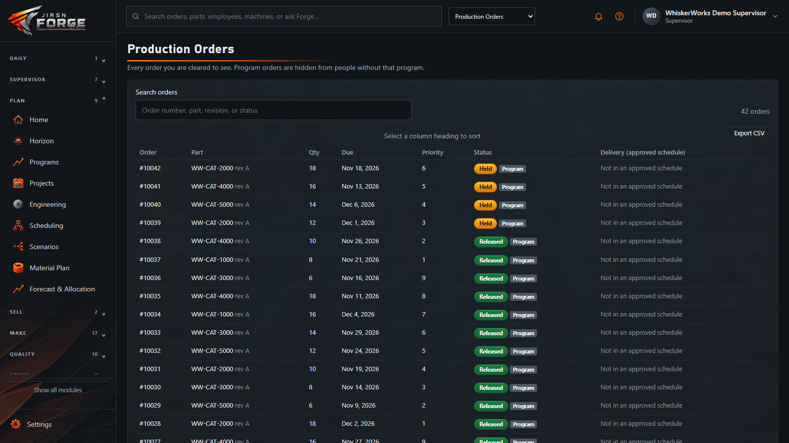 **Production orders** — released only by a second person | 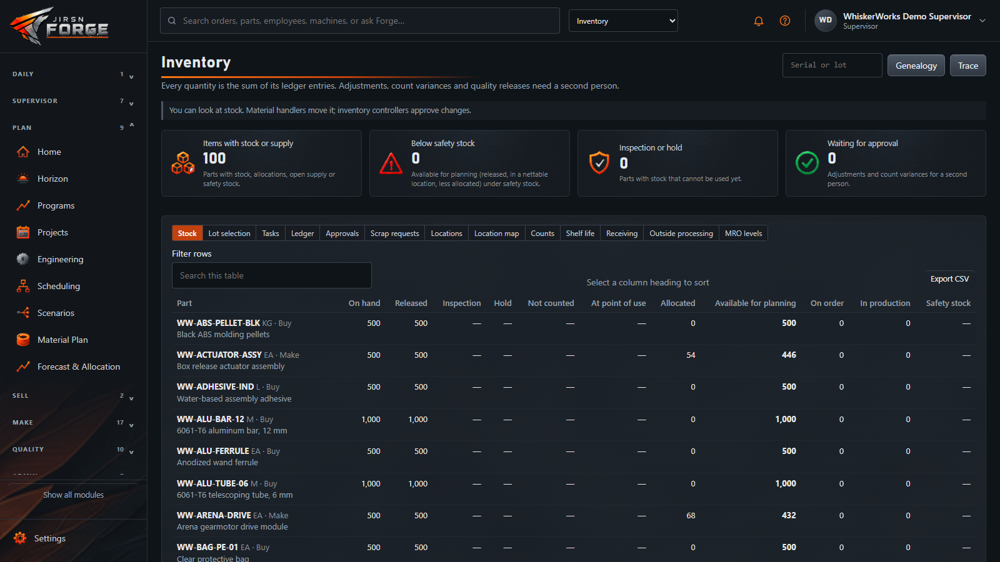 **Inventory** — every quantity is the sum of its ledger |
| 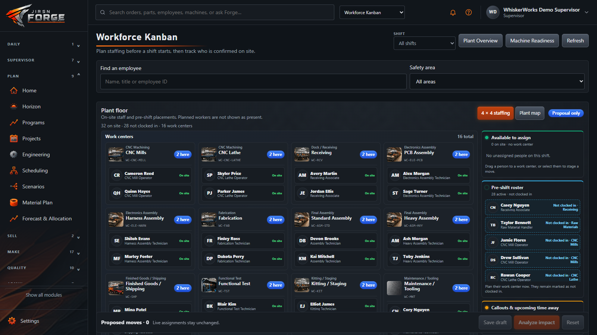 **Workforce** — who is on site, qualified and where | 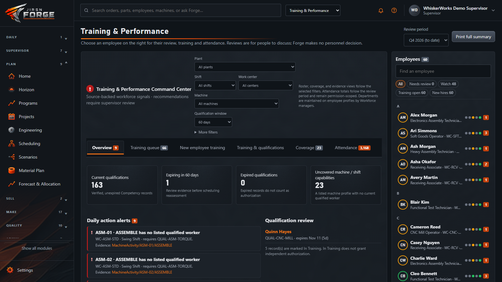 **Training & performance** — qualifications, expiries, attendance |
| 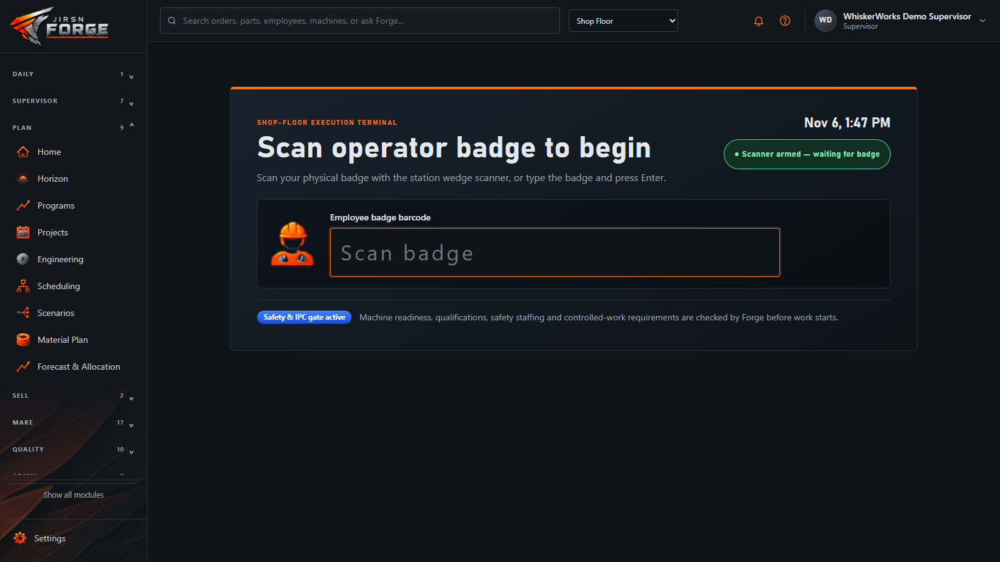 **Operator kiosk** — badge in; readiness, qualifications and safety staffing checked before work starts | 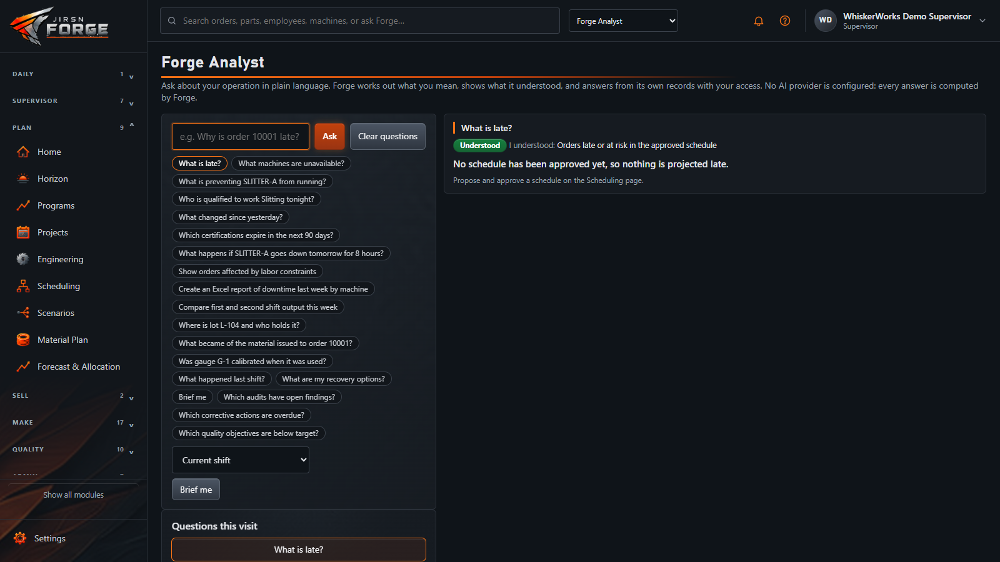 **Forge Analyst** — plain-language questions answered from the records, no AI guesswork |
| 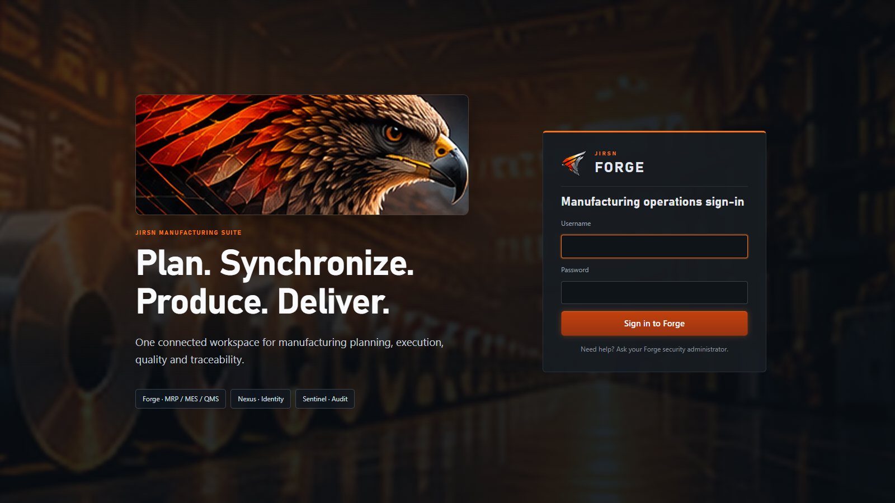 **Sign-in** — built-in accounts over HTTPS, or your company sign-in | 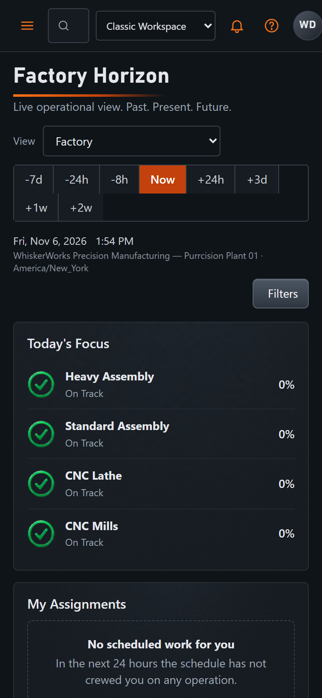 **On a phone** — the same plant in your pocket |

## Built with

- **.NET 10 / ASP.NET Core** — modular monolith: 17 bounded contexts that talk only through contracts, enforced by architecture tests
- **PostgreSQL** — 208 versioned migrations, transactional outbox, event log, append-only hash-chained audit
- **Plain HTML, CSS and JavaScript modules** — no front-end build step; dark industrial UI, phone and kiosk layouts
- **Deterministic engines** — scheduling, MRP and forecasting are pure functions over a snapshot with input/output fingerprints

## Tested

Nearly **1,000 automated tests**, all passing at v1.0.0: 442 integration tests against a real PostgreSQL through the real
HTTP host, 410 planning-engine tests, 52 kernel tests, 40 architecture rules, plus UI page tests — and an installer self-test
that installs Forge end to end in a scratch folder.

## Try it

1. Download `JISRN-Forge-Setup-1.0.0.exe` from **Releases** and run it as an administrator on a Windows 10/11 or Server PC.
   It installs Forge and its own PostgreSQL as Windows services, over HTTPS.
2. Open the address it shows, enter the setup code, and create the first administrator.
3. Optional: load the WhiskerWorks sample plant with `tools\load-sample-data.cmd` and sign in as `ww-demo-planner`,
   `ww-demo-supervisor` or `ww-operator-001`.

Details: [Installing Forge](docs/installing-forge.md).

## Build from source

```
dotnet build Forge.slnx
dotnet test Forge.slnx          # needs PostgreSQL 16+ (see docs/technical-reference.md)
tools\package-installer.cmd     # builds dist\JISRN-Forge-Setup-<version>.exe
```

## Documentation

- [Technical reference](docs/technical-reference.md) — every phase, context, API and rule in detail
- [Installing Forge](docs/installing-forge.md) — server install, upgrade, backup and removal
- [Architecture decisions](docs/adr) — why things work the way they do

---

Part of the JIRSN manufacturing suite: **Forge** (MRP / MES / QMS) · **Nexus** (identity) · **Sentinel** (audit).
