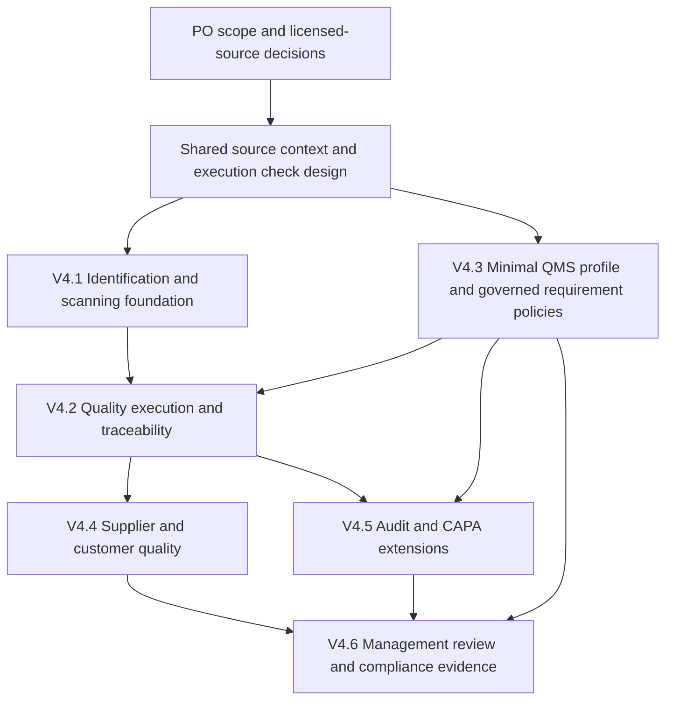

# JIRSN Forge V4 — Architecture Impact Review

Date: 2026-10-12. Status: **PROPOSED — architecture review only; Product Owner approval required before implementation.**

Inspected baseline: product commit `c298a7fb9376a2bd8a344de2f37bcdd5e09a0a1b`, handoff commit `e54a679`. No V4 application code, migrations, endpoints, permissions or tests were implemented. No V3 application code was changed. The previous V3 local verification remains historical evidence: Planning 278, Kernel 33, Architecture 32, Integration 148 and Node 34 passed. Those tests do not prove the proposed V4 scenarios.

This document supplies all twenty deliverables requested in section 42 of the preserved [V4 request](<C:/Users/wrest/Documents/JISRN Forge/docs/v4/sources/v4-master-request.md>). The [coverage register](<C:/Users/wrest/Documents/JISRN Forge/docs/v4/iso-coverage-register.json>) records every capability in sections 3–40 with edition/clause family, provisional interpretation/classification, applicability, reuse, new work, evidence, human responsibility, validation and open questions. Detailed repository assessments accompany this review; E01–E32 below identify the inspected code.

## 1. Executive architecture summary

Extend the existing .NET modular monolith and PostgreSQL bounded-context schemas. Quality owns QMS governance, investigations, audits and management review. Engineering continues to own controlled documents and technical configuration; Inventory owns material identity, quantities, custody and shipments; Resources owns tools and calibration; Execution owns work and actuals; Procurement owns supplier controls; Workforce/Competency own manufacturing competence; Kernel owns authorization, command transactions, audit, holds and events. Planning composes authorized read views and defined metrics from those sources. Nexus remains the identity/assurance authority. No second inventory, genealogy graph, evidence store, authentication system or workflow engine is proposed.

The highest-value foundation is **controlled execution and attributable evidence**, followed by QMS governance and assessment. Labels are references to existing entities. A scan proposes an action; only the existing authorized business command records movement, consumption, inspection or production. An investigation identifies potentially affected records; Quality assesses them and separately authorizes containment. Evidence mapping helps an auditor locate records; it does not decide conformity.

Five prerequisites need explicit implementation approval and acceptance evidence before dependent V4 features can be released:

| Gate | Finding from the inspected baseline | Consequence for V4 |
| --- | --- | --- |
| G1 — shared execution checks | Start currently checks local holds/operator/machine/optional named tool and a resource safety preview, without consuming the complete documentation/material/predecessor readiness checks (E01–E02). | A scan/readiness screen cannot establish Scenario A. Reuse common checks inside every applicable authoritative command, including direct API calls. |
| G2 — acceptance and release scope | Production receipt can directly post Released stock; the latest passing operation inspection is not exact lot/serial/quantity acceptance coverage (E03–E04). | Introduce an explicit product-release decision and coverage rules over existing Quality and Inventory records. |
| G3 — contextual evidence access | CAPA currently lacks inherited source context; audit projections omit marking checks; queued email is not reauthorized at delivery (E05, E12–E14). | Resolve real source scopes before reads, replay and writes; recheck current delivery/export access. Do not extend these paths with sensitive QMS data first. |
| G4 — reliable metrics | The existing “first-pass” report sums all inspections; report totals/grouping use a capped presentation population (E06–E07). | Define first-attempt cohorts and calculate complete authorized aggregates before pagination. |
| G5 — complete investigations | Ordinary genealogy traces and inspection joins have finite display limits (E08); failed calibration has no retrospective investigation (E09). | Return completeness/gap indicators and complete permitted investigation results, rather than claiming every affected product is known. |

These are review findings, not fixes made during this session. An implementation approval must identify which baseline corrections it authorizes. A passing V3 test suite is not a substitute for the new direct-API and complete-population acceptance gates.

### Standard-source position

ISO's current catalog identifies ISO 9001:2026 as edition 6, published on **16 September 2026**, replacing the previous edition. The public summary highlights leadership/quality culture and separate treatment of risks and opportunities. This confirms the requested edition, but is not the licensed normative text. [ISO catalog](https://www.iso.org/standard/9001), [ISO public revision overview](https://www.iso.org/quality-management/iso-9001-2026).

No authorized full copy of ISO 9001:2026, the 2015 edition or their normative redline was supplied or found in the inspected project. No purchase was made. Detailed requirement meaning, exact subclauses, applicability and transition deltas remain **RequiresLicensedVerification**. The architecture can be reviewed now; full clause conformity cannot be asserted. Sector/customer/regulatory requirements need their own controlled sources and applicability decisions.

## 2. ISO 9001:2026 clause coverage matrix

This is a **provisional capability-to-clause-family map**, not a statement of normative coverage or conformity. Clause families follow the supplied request and publicly described management-system structure. No 2015 subclause number is silently promoted to a verified 2026 locator. The register's exact normative reference remains empty until a qualified reviewer checks an authorized source.

Classification: **M?** = candidate mandatory QMS outcome; **C?** = candidate conditional requirement; **P** = organizational/customer policy; **O** = optional software/technical mechanism. The question mark is deliberate: a licensed review must finalize ISO classifications. “Optional mechanism” does not remove an applicable quality obligation. Every row has an organization-defined applicability decision and an accountable human; software does not infer QMS scope.

| 2026 family | Register IDs / user sections | Proposed coverage and existing foundation | Classification / verification |
| --- | --- | --- | --- |
| 4 — organizational context | R03: scope/processes | Controlled QMS profile, context/interested parties/requirements and process map; existing site/program/document references | M?; exact requirement and justified exclusions require licensed review |
| 5 — leadership | R04: policy/responsibilities | Controlled policy via Engineering, ownership and communication/acknowledgment records | M? / P; culture and ethical-policy details need source verification; acknowledgment is not understanding |
| 6 — planning | R05–R07: risks, opportunities, objectives, changes | Distinct risk/opportunity evaluation and planned actions; QMS objectives reference defined facts; governed QMS changes reuse command/evidence patterns | M? / P; FMEA/scoring and specific change forms remain optional methods |
| 7 — support | R08–R11: competence, measurement resources, documents, retention | Existing qualification/training, calibration and document control; add effectiveness, retrospective impact and retention/disposition governance | M? / C? / P; exact competence/traceability/retention obligations need licensed and applicable-source review |
| 8 — operational identification/traceability | R12–R20: canonical identification, labels, scans, genealogy, investigations | Existing material/task/work/tool identities and genealogy; governed resolver/label/scan presentation; human investigation/containment | C? for required traceability; O/P for barcode choice, devices and scan mechanics |
| 8 — operational quality | R21–R29: requirements, design, supplier controls, production, inspection, release, NCR, property, post-delivery | Extend existing Engineering, Procurement, Quality, Inventory and Execution; add requirement review, release decisions, customer/property cases and provider evaluations | M? / C? / P; design and post-delivery applicability must be organization-defined |
| 9 — evaluation | R30–R34: metrics, satisfaction, audits, evidence mapping, management review | Complete scoped metrics and frozen review packs; new business audits/findings/reviews; existing CAPA and document/audit links | M? for applicable outcomes; O for a clause-mapping interface; exact evidence adequacy is human judgment |
| 10 — improvement | R35–R36: corrective action/improvement | Extend existing CAPA rather than replace it; evidence-supported investigation, effectiveness and recurrence; improvement actions | C? / M?; register/form and particular root-cause methods are O/P |
| Cross-cutting support/operation/evaluation | R37–R40: Analyst, notifications, security, evidence integrity | Existing deterministic services, outbox, scoped permissions, signatures and document hashes; address G3/G4 before broader exposure | O/P for software methods; underlying applicable record/control duties require verification |

For **each** R03–R40 entry the JSON register includes all eleven requested attributes, plus source provenance and verification status. Evidence IDs, validation scenarios and decision IDs connect it to the following sections. There is no “compliant” flag derived from file count, AI output, acknowledgment or checklist completion. Use independent fields for applicability, implementation status, evidence availability and human assessment.

## 3. ISO 9001:2015-to-2026 transition mapping

Version standards as `standard + edition + amendment + licensed source reference`. Model mappings as many-to-many reviewed records: Unreviewed → Proposed → Verified → Approved/Superseded. Preserve legacy procedure/evidence applicability; a new edition must not overwrite a historical assessment. A mapping can be unchanged, clarified, split, merged, newly applicable, no longer applicable or unresolved; those values are reviewer conclusions, not AI defaults.

| Transition area | Legacy evidence to inventory | 2026 target action | Approval gate |
| --- | --- | --- | --- |
| Context / scope | 2015 QMS scope, process map, parties and requirements | Reassess current context and applicability against the licensed 2026 source | QMS owner verifies; no inferred exclusions |
| Climate consideration | Applicable 2015/Amd 1:2024 assessment and requirements | Retain provenance; verify how the subject appears in the new edition | Source-controlled interpretation; no mandatory universal score |
| Leadership / culture | Policy, responsibilities, communication and reviews | Review public-change themes against exact obligations; record gaps/action owners | Leadership and QMS owner approve |
| Risks and opportunities | Existing method, register and action effectiveness | Classify risk and opportunity separately; preserve original method and evidence | No forced FMEA or matrix; licensed delta review |
| Resources / competence / documentation | Assessments, calibration, applicable procedures, retention requirements | Identify evidence adequate for each verified target requirement; flag missing historic facts | Attendance/acknowledgment cannot become competence |
| Operation / customer / external providers | Requirements, inspections, released product, supplier evaluations | Map existing procedures and identify actual process/control gaps | Domain owner + Quality; distinguish sector/customer conditions |
| Evaluation / audits / review | Metrics definitions, audit criteria, review decisions | Update edition-specific criteria and preserve prior assessments | Qualified auditor judges adequacy |
| Improvement | Corrections, CAPA, effectiveness and improvement results | Link to verified target requirements without declaring automatic conformity | Independent effectiveness/closure decision per policy |

The 2024 amendment is a real separately identified legacy source, not invented V4 functionality. [ISO amendment catalog](https://www.iso.org/standard/88431.html). ISO's public transition guidance describes a three-year transition and directs organizations to their certification body for their schedule; Forge should record the organization's confirmed deadline and evidence, rather than invent a certificate expiry. [ISO transition guidance](https://www.iso.org/quality-management/iso-9001-2026).

The old standard's catalog status and an organization's certificate status are separate records. Capture certification body, certificate scope, validity dates and transition plan if the organization needs them; do not infer that a withdrawn catalog edition instantly invalidates every certificate. The exact clause/redline mapping is intentionally pending licensed review, not missing behind a “fully covered” heading.

## 4. V3 capability reuse assessment

The [operational reuse assessment](<C:/Users/wrest/Documents/JISRN Forge/docs/v4/operations-reuse-assessment.md>), [QMS governance assessment](<C:/Users/wrest/Documents/JISRN Forge/docs/v4/qms-governance-assessment.md>) and [platform impact assessment](<C:/Users/wrest/Documents/JISRN Forge/docs/v4/platform-impact-assessment.md>) form the evidence appendices. They preserve the read-only contributors' source observations; this integrated review supersedes their earlier source-availability notes. The following is the proposed integration decision:

| Existing owner | Reuse | Extend / limit |
| --- | --- | --- |
| Kernel | CommandPipeline, authorization, scoped grants/delegation, holds/signatures, audit/outbox, assignments | New business permissions and source resolvers; address audit classification and replay context; no second BPM/permission engine |
| Inventory | Ledger, canonical instances, split/merge, allocation/movement, receiving/RTV, processor custody, packaging/shipping/returns | Product-release consumption, legal-owner agreements and preservation requirements; never maintain QMS stock balances |
| Execution | Released orders/routing snapshots, labor/qualifications, actual output, historical as-built and terminal session protection | Transactional shared start checks, exact output/inspection subjects and trusted equipment/instruction provenance |
| Engineering | Internal/external/reference documents, applicability, revisions, file hashes, change reviews and evidence target resolver | QMS record targets, retention governance, process/requirement references; keep technical and QMS change semantics distinct |
| Resources / Competency / Workforce | Tool identity/calibration/service, qualifications, training and assignments | Out-of-tolerance finding and typed use links; competence/effectiveness evidence; no HR or authentication store |
| Quality | Inspection plans/results, NCR/disposition, FAI, CAPA | Subject/coverage/units, investigation, release decisions, QMS governance, audits/findings/reviews; CAPA is already implemented in a smaller form |
| Procurement / Programs | Supplier and approved-source masters, technical packages, quotes, PO, program/contract/demand | Evaluation/reevaluation and approval scope, accepted customer requirements and controlled customer references |
| Planning / Host | Authorized read services, reports/Analyst, genealogy and temporal projections, notification rules/UI | Complete metrics/investigation queries, QMS surfaces and evidence packs; summaries remain read models |

QMS procedures can reference existing manufacturing instructions. A quality policy can use the existing controlled document lifecycle. A QMS process map is **not** a production routing, a QMS objective is **not** a scheduled production goal, and management-review actions are **not** capital-project accounting. Reuse authority/evidence and explicit contracts without forcing unrelated domain semantics into an existing entity.

## 5. Missing QMS capability assessment

**Structured capabilities not found:** organization-approved QMS profile/process map/interested parties; QMS risk/opportunity register; quality-policy governance/communication; QMS objectives with metric definition; QMS change/effectiveness review; supplier evaluation/reevaluation workflow; complaint/feedback/satisfaction cases; internal audit program/finding workflow; clause/edition assessment mapping; management-review meeting/input/decision packs; continual-improvement register; retention/legal-hold/disposition policies; universal label/scan management; calibration-impact and traceability investigation; distinct finished-product release decisions; legal ownership/loan/consignment and property incidents.

**Partially implemented and to extend:** CAPA, document control, training/qualification, inspection, supplier approval, post-delivery returns, historical genealogy, evidence integrity, notifications and reporting. For example, current CAPA requires root-cause/action text at opening, links at most one NCR and progresses Open → Implemented → Verified with an independent verifier. It lacks the broader investigation/owner/effectiveness/source-context model; replacing it would duplicate a working record (E05).

**Conflicting assumptions requiring a decision:** an entire order's latest inspection pass versus exact accepted quantities; “Released” production receipt versus human release evidence; free-text customer identity versus stable customer-scoped authority; append-only files versus authorized destruction; read-side readiness versus command enforcement; bounded traces versus exhaustive containment. Treat these as design gates, not silent reinterpretations of historic V3 records.

Do not add a separate QMS database/service solely because the screen is new. Start by adding QMS-owned tables and contracts to Quality. Reconsider a separate bounded context only if measured ownership/dependency complexity warrants it; it would still use the existing database, Kernel and source-owned contracts, not duplicate operational facts.

## 6. Barcode and identification architecture

Use a canonical reference containing organization namespace, entity type and the **existing authoritative key**. Examples: person GUID; order number; operation `(order, sequence)`; material `(part, lot/serial)`; machine/tool/location code; container code; inspection/shipment ID. A lot number alone is ambiguous across parts (E08). A traveler is a controlled presentation/version of an order and routing, not another production order. WIP/remnant is an Inventory instance or an explicit recorded work/output reference, never an invented identity from its display name.

The namespace prevents collisions; it is **not tenant isolation**. The inspected permission/source model does not establish an organization/tenant boundary across every record. Prefer one organization per Forge deployment unless D02 approves and validates a separate tenancy design. Resolve only the configured organization namespace, then enforce existing actual source access. A multi-organization QMS deployment would require explicit authenticated tenant context, source ownership, reads/writes/exports and migrations across all affected contexts; a label prefix cannot supply it.

One bounded decoder accepts configured Code 128, QR, Data Matrix and future adapter outputs. A namespaced, versioned envelope or short opaque alias resolves to the canonical reference through owner contracts. Escaping, length limits, allowed entity types and legacy/customer/supplier alias mappings must be deterministic. Alias and label records hold **no stock quantity**. Foreign/unknown/ambiguous/void references fail clearly. A barcode cannot execute URLs, scripts or commands and its possession grants no record access.

Proposed presentation records: Label, LabelTemplateVersion, PrintAttempt and AliasMapping. Record canonical subject, symbology, template/hash/version, human-readable identification, issuer/time, optional device/printer, print status, reprint reason, replacement/void relationship, correlation and audit. Reprint references the same physical subject; voiding a label does not void material. Printer acceptance is not proof of printing or attachment. Uncertain/failed jobs require an operator decision; they must not create inventory.

Two identical physical copies cannot always be detected from their barcode alone. Distinguish valid repeated scans/multiple labels from a conflicting serial/location or tracked label-copy state. Use existing uniqueness, ledger and idempotency checks plus physical verification. A checksum may detect corruption; it is neither authentication nor proof of custody. No scanner vendor or cryptographic authenticity scheme is selected in this review.

## 7. Scan-to-execute workflow design

Operation policy determines necessary scans/checks, not a universal eighteen-scan checklist. A trusted terminal can supply machine/location context; an authorized manual lookup can be permitted with provenance. Showing an instruction does not prove use or understanding. Authentication, operation authority, qualification, document applicability, material revision/status/location/quantity, tooling/calibration, predecessors, inspection and configured safety gates remain separate checks.

The server re-resolves actual source context **before authorization/replay** and runs relevant shared checks again inside the business transaction. Use pure rule implementations or context-owned check ports; Execution must not depend on Planning implementation classes. Reuse existing locks, expected versions and idempotency. Proposed replay keys/fingerprints must bind the originating authenticated identity, acting operator where relevant, logical command and source; the current globally keyed store alone does not establish actor-safe replay (E16). Reuse a key for one logical retry and reject a different body/actor/source instead of disclosing another actor's stored result. Preview tokens may identify a reviewed snapshot, but cannot substitute for current checks. Missing or indeterminate required data cannot be labeled Pass.

A ScanSession holds current operator plus authenticated terminal actor, policy version, work references and staged selections. Switching, locking, expiry or outage invalidates staged actions/responses through existing session-revision protection (E11). Commands commit individually; the entire workflow is not one long database transaction. Accepted scan-driven commands emit ordinary domain events. Rejected/raw attempts are bounded, redacted telemetry with outcome codes; they are not manufactured production facts. Never retain PINs, tokens or raw badge secrets. Offline consequential execution remains outside this proposal; existing outage lock/no-queue behavior applies.

## 8. Quality domain model proposal

Add narrowly scoped aggregates under their existing owners:

| Aggregate / extension | Owner | Key relationships and invariants |
| --- | --- | --- |
| QmsProfileVersion / ProcessDefinition / RequirementApplicability | Quality | Organization/site scope, named owner, justified applicability, controlled procedure revisions; organization-approved effective version |
| RiskOpportunity / QualityObjective / QmsChange | Quality | Distinct risk/opportunity kind, configured evaluation method; objective references metric definition; changes include verification/effectiveness |
| Inspection subject/criteria/coverage | Quality / Inventory receiving | Exact lot/serial/output/receipt reference, frozen plan/criteria/unit/method, sample/cohort and per-result equipment/time; preserve original records |
| ProductReleaseDecision | Quality | Identified accepted quantity/serial scope, requirement version, coverage/inspection/concession evidence, authority/assurance/signature, expected version and append-only correction |
| TraceabilityInvestigation / CandidateAssessment | Quality | Trigger, interval/scope, snapshot/cutoff, evidence paths, completeness/uncertainty, human include/exclude/disposition; uses existing genealogy and HoldService |
| MeasurementResourceFinding | Resources with Quality assessment | Gauge/tool, as-found observation and range, discovery time, suspected interval and supporting basis; links to inspection subjects/investigation |
| SupplierEvaluation / ApprovalScope | Procurement | Existing supplier code, product/service/process scope, criteria/version, evidence, approval/expiry/reevaluation; a checkbox alone is insufficient |
| CustomerFeedback / Complaint / PropertyAgreement / PropertyIncident | Quality, with Programs/Inventory/Resources contracts | Controlled customer reference; original shipment/material/tool; ownership separated from custody/location; communication and disposition authority |
| AuditProgram / Audit / Finding / ManagementReview / Improvement | Quality | Business scope/criteria, impartiality/competence assessment, evidence links, frozen review inputs, decisions and existing assignment/CAPA references |
| Capa extension | Quality | Existing CapaId retained; multi-source links, owner, investigation state, proposed versus verified cause, planned actions, effectiveness and recurrence |
| StandardEdition / RequirementMapping / EvidenceAssessment | Quality | Edition-specific licensed requirement reference, explicit applicability and human assessment; linked evidence does not mean conformity |

No new quantity, qualification, customer-shipment, tool-validity or genealogy truth is stored in these QMS aggregates. Capture immutable **evidence references/snapshots** where a decision needs its historic basis; projections remain recomputable and show their cutoff/version.

Preserve current CAPA API/state compatibility for existing records. Add an investigation stage that permits genuinely unknown cause; do not satisfy a non-null root-cause column by inventing one. Verified historic CAPA keeps its original state/history. New verification must name effectiveness criteria, observation interval, results and independent authority; ineffective outcomes reopen or create linked follow-up under controlled rules. NCR correction/disposition and corrective action remain different records.

Product release authorizes only the identified accepted scope. Inventory consumes the decision through a contract in the existing ledger transaction; reserve the approved quantity to prevent double release/ship. Production receipt must no longer implicitly stand in for release where the adopted policy requires a distinct decision. A partial hold may require a child instance or disjoint status balances; a whole-lot Kernel hold intentionally blocks the whole lot. Decide this granularity explicitly, rather than interpreting 80 held units as either all 1,000 or zero.

## 9. Audit and evidence model proposal

Separate a **QMS business audit** from Kernel's **transaction audit log**. An audit finding expresses a qualified auditor's assessment against criteria; a transaction entry proves an attributed recorded action under the application controls. Neither proves a physical observation or overall conformity on its own.

Audit program → scoped audit → competence/impartiality approval → planned criteria/version → evidence capture → reviewed findings/report → linked correction/CAPA → verified follow-up → closure. Checklist format, frequency and auditor separation are organization policies constrained by verified applicable requirements; avoid one universal checklist.

Reuse Engineering document/file/link storage and target resolution (E10). An EvidenceReference names owner/type/ID/version, source, creator/time, classification, applicable scope, file hash where relevant and retention category. It can point to a measurement, business transaction, procedure revision or external evidence. An EvidenceAssessment independently stores adequacy, limitation, assessor/role/date, criterion/edition, rationale and superseded assessment. An empty link, stale view, inaccessible source or incomplete cohort is not adequate evidence by default.

Assessment packs freeze definition versions, authorized scope, source IDs/versions, time cutoff, completeness, query/metric version and hash of the manifest. A later revocation still gates viewing/exporting the pack; historic participation does not grant permanent access. External signed-file review remains distinct from cryptographic signer validation (E10). Amendments append history, never silently replace the original basis.

## 10. QMS governance model proposal

Use controlled domain transitions through CommandPipeline. Proposed examples: profile/process/policy Draft → Reviewed → Approved → Effective → Superseded; risk/opportunity Identified → Evaluated → ActionPlanned → Implemented → Reviewed; QMS change Proposed → ImpactReviewed → Approved → Implemented → Verified → EffectivenessReviewed; complaint Received → Triaged → Investigated → ResponseAuthorized → Resolved → Closed; management review Planned → InputPackFrozen → Held → DecisionsApproved → FollowUpOpen → Closed.

Statuses describe facts; an acknowledgment is not competence, “meeting held” is not actions completed, and an implementation note is not effectiveness verification. Reuse Kernel WorkAssignments for owned follow-up work with new supported source resolvers; assignment completion does not close CAPA/audit/complaint source records. Avoid a new generic workflow engine, arbitrary runtime forms language or blanket two-person rule for every edit. Consequential transitions get specific reviewed authority/assurance/SoD policy.

The organization approves QMS scope, owners, interested parties, evaluation methods, applicability, quality-policy communication, objective measurement and review cadence. Legal/regulatory/customer sources remain controlled external references with human applicability decisions. Climate relevance can be recorded with a rationale; neither AI nor an empty checkbox determines relevance. Applicable design/development and special-process controls can reference an external PLM/process authority without recreating its design system.

## 11. Authorization and Nexus integration review

Nexus issues authenticated identity/assurance; Forge resolves active manufacturing identity, permissions, program/facility/contract/customer scope, markings, current delegation, qualification, duties and record state. Keep authenticated terminal/service principal and acting operator distinct in accepted transactions. A barcode can select an identity; it cannot supply trusted `acr`, `auth_time`, permissions or qualification.

Reuse signed-token validation, configurable step-up, SCIM deactivation, time-bounded delegation and signatures (E15). Add business actions such as QMS profile approve, audit conduct/report approve, investigation assess, product release, CAPA effectiveness verify, supplier evaluation approve, retention disposition and controlled evidence export. These are proposed catalog entries, not permissions created now. Map actual source dimensions to ResourceRef; independent program membership must not widen a scoped permission.

A CAPA/investigation/audit/complaint referencing multiple sources must require the permitted context for each consequential action. Do not collapse mixed programs to an unscoped resource. Read views may show an explicitly incomplete authorized subset; decisions requiring all relevant evidence must fail or be routed to an authorized reviewer. Re-resolve context/version inside the transaction. Cache grants only within their validity boundary; queued notifications and download/export recheck current access.

Quality release/concession and impartial auditor/independent effectiveness duties must not be bypassed by convenience administrators. Define who proposes/approves a policy and who can perform each business act. Provider assurance is trusted only from configured validated claims. Live Nexus federation, deactivation and assurance mapping remain deployment acceptance; existing local development-header/fake-provider tests do not prove the integration.

## 12. Event and notification impact review

Extend EventFactory/outbox, not an independent QMS event bus. Proposed events include QmsProfileApproved, QmsChangeApproved/Verified, SupplierEvaluationApproved, ComplaintReceived, InvestigationOpened/Assessed, MeasurementResourceFindingRecorded, ProductReleaseApproved, AuditFindingRaised, CapaEffectivenessVerified, ManagementReviewDecisionsApproved and LabelPrintRequested/Confirmed/Failed. Accepted scans continue to emit their owning business events; raw attempts do not impersonate movements or production.

Events identify actual source/subject/version, actor, time, scope/markings, reason, correlation and explicit causation only when a real recorded relationship exists. Sensitive payloads should carry references/minimum data; recipient-specific content comes from an authorized projection. Missing markings on audit/event paths are G3 acceptance issues, not permission to broadcast private QMS data.

Reuse notification rules, deduplication, quiet hours, resolution and delivery retries (E13). Qualification/calibration expiry and due dates need a deterministic scheduled evaluation that creates a condition only when current facts satisfy it. Delivery resolves active recipient access, effective scope/markings and permission immediately before sending; revoked recipients are suppressed/redacted with traceable outcome (current email gap E14). Failure cannot reverse the source transaction. A resolved alert or acknowledged email does not close its source action. Customer complaint/recall communications require explicit human approval and an authorized audience; investigation creation sends none automatically.

Do not assume exactly-once side effects or one global causal order across multiple hosts. Before adopting that deployment topology, specify subscription leases/checkpoint coordination, duplicate/out-of-order version handling, provider idempotency and poison-event quarantine/replay. A successful source transaction remains durable when a projector or external provider fails; projections expose lag and source cutoff. Existing event/subscriber mechanisms require topology-specific tests before sensitive QMS automation relies on them.

## 13. Database and migration impact review

All schema changes below are **proposals**. Retain PostgreSQL/Npgsql, context ownership, contract-only dependencies, one transaction/audit/outbox path and current 88-migration baseline. Do not edit applied migration files or add V4 SQL during this review.

| Owner | Additive proposal | Migration/compatibility boundary |
| --- | --- | --- |
| Quality | QMS profile/process/risk/objective/change; investigation/assessments/release; audit/finding/review/mapping/feedback/improvement; CAPA origin/history/effectiveness | Preserve CAPA IDs/states, old inspections and old assessment meaning; unknown historic source/coverage stays unknown |
| Quality / receiving Inventory | Inspection subject, frozen plan/criteria/unit and cohort/equipment evidence links | Existing receipt/order inspectors and raw results remain authoritative; no invented historic lot/gauge links |
| Resources | Typed tool use and as-found findings | Keep original calibration/use events; retrospective assessment is append-only additional knowledge |
| Procurement / Programs | Supplier evaluations/approval scopes; controlled customer-reference/legacy-alias mapping if adopted | Ambiguous customer names require a human decision; never silently merge equal text |
| Kernel / Host identification | Label/alias/print-attempt and redacted scan-session/attempt metadata | No inventory quantities or authentication secrets; no competing global entity database |
| Engineering retention | Effective policy, record-category assignment, legal holds and disposition request/approval/result; Kernel supplies shared reference/authorization/audit/outbox contracts only | Existing file/revision immutability remains; actual purge is a separate approved design, not a deletion endpoint; source contexts retain ownership of their records |

Index exact subjects, tool/use intervals, case scope/status/owner/due date, mappings by edition/criterion, labels by canonical reference/status, and release decisions by reserved quantity/subject. Add uniqueness, foreign/context-reference validation, append-only history and source/version compare-and-set where consequential. Multi-source records need an explicit source-scope association, not a nullable program column interpreted as global access.

Use dependency-ordered additive migrations and tests of populated upgrade, idempotent application and rollback/recovery. Backfill only verifiable recorded provenance; label old missing values Unknown/NotRecorded. Do not invent lot coverage, owners, causes, conformity assessments or qualified people. No automatic four-QMS-engine schema partitioning is needed for the archetypes.

## 14. API impact review

Routes are proposed contract families, not implemented endpoints:

| Family | Proposed purpose | Write boundary |
| --- | --- | --- |
| `/api/identification/resolve`, `/labels`, `/print-attempts` | Typed authorized resolution and controlled label lifecycle | Printing cannot create stock; reprints/voiding audited |
| `/api/scan-sessions`, `/scan-attempts` | Staged task/identity selection and redacted validation outcome | Accepted action calls the existing domain command; session is not authorization |
| `/api/quality/qms-profiles`, `/processes`, `/risks-opportunities`, `/objectives`, `/qms-changes` | Governed scope/process/policy/action records | Effective version requires reviewed authority and version |
| `/api/quality/investigations`, `/measurement-findings`, `/product-releases` | Candidate impact, evidence assessment and release decision | Human decision; actual source context, evidence coverage and current transaction checks |
| Existing inspection/CAPA routes | Subject/criteria/cohort/equipment and investigation/effectiveness extensions | Preserve old contract behavior; new governed workflow requires explicit opt-in/version |
| Supplier evaluations / customer-quality cases | Existing supplier and controlled customer/shipments | Evaluate approval scope; no inferred customer identity or unauthorized outbound message |
| `/api/quality/audits`, `/findings`, `/management-reviews`, `/requirement-mappings`, `/evidence-assessments` | Edition-specific audit/review/evidence decisions | Auditor assessment distinct from evidence collection; source-state decisions never hidden behind assignment completion |
| Retention policies / holds / disposition requests | Governance and approval of retention | No purge implementation in initial scope |
| Existing reports/Analyst/exports | Defined QMS metrics and evidence retrieval | Full authorized aggregate before row pagination; current access and complete/partial indicators |

Every consequential command needs reason, idempotency, actual scoped authorization, assurance where configured, expected version and auditable outcome. Pagination must be stable and bounded without silently truncating investigation/aggregate results. Denials should not leak inaccessible source titles or private scan identities. Error codes distinguish invalid/ambiguous identity, stale context, insufficient assurance, blocked execution, missing coverage and unavailable/incomplete evidence. Do not expose arbitrary SQL, AI-authored mutations or unauthenticated scan-write APIs.

## 15. UI/UX impact review

Operators see current operator, selected work/operation, applicable instruction, required material/resources, next necessary action and a concrete block reason. Automatically supply trusted terminal context and authoritative source data. Give accessible text entry/manual lookup, clear focus, live validation status, keyboard flow, modal trapping and lock/switch actions. Keep clause codes, schema names and CAPA administration out of routine operator work.

Quality sees investigation candidates grouped by physical inventory/WIP/allocations/staged/shipped/unknown, inspection coverage and release decisions. Show original historic validity alongside later calibration concerns, with explicit uncertainty. A review must not make candidates look confirmed defective. Print/scan uncertain status gets a recovery action and physical confirmation, not an invented successful transaction.

Process owners see profile/process/risk/objective/action forms. Auditors see criteria/edition, evidence adequacy and impartiality checks. Management sees a frozen review pack, metric definitions/completeness and outstanding decisions/actions; a live dashboard is visibly different. “Awaiting verification,” “Unknown,” “Not applicable with approved rationale” and “Verified” remain distinct. No green “ISO certified” score based on fields filled. Industry templates prefill choices only; they do not establish applicability or compliance.

## 16. Security and record integrity review

Reuse validated authentication, least-privilege scoped commands, classification-aware source reads, immutable inspection/document history and SHA-256 file validation. Existing database triggers and audit chaining provide application-level protection/tamper evidence under their privileges; they do not guarantee immutability against an unrestricted database/host administrator (E16). Require restricted DB roles, controlled schema changes, protected independent backups/checkpoints and tested restoration before stronger deployment claims.

Retention must define category, effective policy/version, trigger, duration, owner, applicable customer/contract/legal source, holds, disposition authority and destruction evidence. There is no universal duration assumed. Begin with policy/hold/disposition metadata and **no purge path**. Later physical deletion must reconcile append-only triggers, shared file deduplication, every source reference, pending investigation, legal holds, derivative packs/exports, replicas and backups. Removing one attachment cannot justify deleting a shared file. Unknown retention/hold status fails closed for disposal. Privileged maintenance is separately approved and audited; do not introduce an ordinary API bypass around immutable records.

Audit/evidence export must enforce current source permissions and markings, scoped redaction, purpose/authority and immutable manifest provenance; a raw global audit export is not safe for every QMS user (E12). Scan inputs are untrusted; use bounded decoding, safe display and no credential retention. Device identity is optional provenance unless an adopted policy attests it; a client-supplied device string is not trusted hardware authentication. Prevent stale-version signatures, duplicate release, reprint-created stock, forged assurance and cross-operator action replay.

## 17. Reporting and Quality Dashboard proposal

Each metric definition contains owner, version, unit, source/cohort, numerator, denominator, event-time basis, scope, window/timezone, inclusion/exclusion rules, target, completeness and evidence/query reference. Calculate complete authorized populations first; paginate display rows later. Frozen reviews keep their definition/scope/cutoff and data-quality flags. A scoped subset must not be presented as an organization-wide result.

| Metric | Proposed numerator / denominator | Necessary control or current gap |
| --- | --- | --- |
| First-pass yield | Units accepted on the **initial** required attempt **without prior rework/repair** / units in the defined initial-attempt process cohort | Add stable attempt/subject/cohort and production/rework lineage; distinguish process FPY from inspection first-attempt acceptance; do not reuse all passing reinspections as FPY (E06) |
| Scrap rate | Authorized scrapped quantity / defined input or produced quantity, with compatible units | Specify the chosen denominator; never convert unexplained material to scrap; avoid summing component and finished units |
| Rework rate | Unique units requiring rework / defined produced or inspected cohort | Deduplicate rework cycles and separate repair/use-as-is |
| Supplier rejection | Rejected receipt quantity / inspected receipt quantity within source/window | Preserve partial accept/hold/reject, unknown final disposition and same UOM/cohort |
| On-time delivery | Eligible deliveries meeting the **agreed** due rule / eligible deliveries due in window | Define promised vs required date, partial delivery/customer acceptance and historical commitment version |
| Open NCR / inspection backlog | Current open count and aging by state / applicable scoped population where a rate is needed | Counts do not imply product defect or current released quantity |
| CAPA overdue / effective closure | Due unclosed actions; or effective verified actions / actions requiring evaluation | Implementation is not effectiveness; handle reopened actions and missing review window |
| Calibration / qualification gaps | In-scope required resources/people with valid recorded coverage / total in-scope required population | Require applicability; historic validity remains historic; separate overdue status from retrospective concern |
| Complaints / audit findings | Typed counts and aging by source/customer/criterion/window | New structured records; not a satisfaction score by themselves |
| Objective performance | Metric-version result compared with approved target for that scope/window | Unknown/incomplete measurements cannot become zero or “target met” |

Extend the fixed report catalog and deterministic Analyst services. The thirteen Quality Analyst questions in the request must map to authorized service results with interpretations, evidence, time basis and uncertainty. Existing hold, genealogy, inspection/tool and qualification questions reuse their source services; overdue CAPA/audits/clause evidence/management-review/blocked-release questions need the new governed records. AI may restate those results; it cannot supply missing facts, invent a cause or certify conformity. Customer satisfaction needs the organization's chosen feedback processes alongside delivery data; do not infer it from delivery alone.

## 18. Testing and validation plan

No application tests were added or rerun in this review. The following are **future acceptance criteria** after approval; existing test references are starting evidence, not V4 PASS.

| Scenario | Required proof |
| --- | --- |
| A — wrong revision | Wrong presented instruction/material revision rejected by direct start/issue API; legitimate older applicable revision accepted; changed applicability after preview rejected/rechecked; no mutation on denial |
| B — unqualified operator | Actual expired/revoked qualification blocks authenticated operator at action time; fresh provider assurance does not bypass competence; legitimate supervised policy works |
| C — suspect supplier lot | Complete permitted raw/WIP/child/remnant/allocated/staged/shipped trace with customer references and unknown/hidden/truncated markers; human containment only; unrelated material remains eligible |
| D — failed calibration | Verified suspected interval joins exact inspection/result equipment and subjects through shipment; unknown interval remains explicit; original results unchanged; Quality decides impact/disposition |
| E — duplicate barcode | Reprint/replacement/void affects labels only; retries create no stock; conflicting serial/location blocks; repeated valid scans allowed; indistinguishable physical-copy detection limits tested/documented |
| F — 1,000 produced / 80 held | Exact 920 accepted/released and 80 held scope; issue/pack/ship cannot consume the 80; two concurrent releases/shipments cannot exceed authorized quantities; explicit whole-lot versus partial hold policy |
| G — audit evidence | Criterion/edition-linked procedures, transactions, competence, inspection/release approvals retrievable only with current access; auditor adequacy decision independent of link completeness |
| H — corrective action | Unknown cause permitted during investigation; verified cause/plan evidence, independent effectiveness, recurrence/reopen and multi-source context; immediate correction cannot close corrective action automatically |
| I — complaint | Controlled customer/shipment identity links to historical inspection/genealogy/CAPA; duplicate names/partial returns cannot merge identities or double-credit quantities; communications require authority |
| J — management review | Frozen complete metric/evidence pack, approved decisions/owners/dates, independent action progression; later data/definition changes do not rewrite the past pack |
| K — edition transition | Licensed source review finalizes mappings; many-to-many/unresolved mappings, justified applicability and separate human assessments; existing evidence does not auto-convert to conformity |
| L — shared terminal | Delayed A scans/actions after B switch/idle/outage cannot execute under B; expected actor/operator attribution, assurance boundary, duplicate input and uncertain commit/retry behavior |

Cross-cutting gates: denied and revoked access in APIs/UI/reports/exports/Analyst/email; source scopes and markings; reasoned success/denial audit; idempotent retries with current authorization; expected-version/concurrent mutation races; migration of populated legacy data without invented facts; immutable-history privilege tests; source event versus notification failure; complete query traversal and authorized aggregate totals beyond existing row caps; keyboard/screen-reader/real scanner/printer exercises; live Nexus/Sentinel contract tests; restoration of QMS/release/evidence/retention data.

Performance targets are Product Owner decisions, not claims. Establish measured datasets for the four archetypes, with deep merge/remnant chains, at least 100,000 inspection/result references where the customer volume warrants it, concurrent terminals, printer failures and a revoked-recipient backlog. Measure p50/p95/max, data sizes, completeness, query plans and global audit-lock contention. Agree connected-scan response and investigation/dashboard budgets before implementation. The previous four-question 10-second V3 budget does not establish V4 scalability.

## 19. Implementation dependency map

Approval and licensed normative review are planning gates. Approval to this document alone must not be inferred from silence. Recommended order:

| Increment | Recommended scope / dependency correction | Release gate |
| --- | --- | --- |
| Preflight | Approve scope, licensed-source verification, policy/default decisions and specific baseline corrections G1–G5; recover and compare V3 original source catalog as a separately authorized action | No normative/compliance or execution claim from unresolved assumptions |
| V4.1 | Canonical resolver, labels/adapters and staged session; contextual access/attempt provenance and compatibility; no scan-created inventory | E/L, typed/ambiguous/void IDs, retries and source segregation; foundation checks contract agreed |
| V4.3 foundation, brought forward | Minimal approved QMS profile/process/requirement applicability plus relevant execution/release/retention policies; broader objectives/risk/change work can follow | Organization approves scope/owners/applicability and effective policy versions |
| V4.2 | Transactional shared checks, inspection subjects/coverage, explicit release, complete trace/calibration investigation | A–F, complete scope and preserved history; cannot rely on UI readiness alone |
| V4.4 | Provider evaluation, controlled customer requirements/feedback/complaints, property and post-delivery links | I and approved sourcing/property/communication requirements |
| V4.5 | Business audit/findings, existing CAPA investigation/effectiveness, source-context assignments | G/H, auditor competence/impartiality and current access |
| V4.6 | Licensed edition mappings, full metric definitions/cohorts, frozen review packs/dashboard/Analyst | J/K and all earlier regressions; no automatic conformity conclusion |

Retention **governance** must exist before new evidence categories are deployed. Physical purge and offline production remain separate approved projects. Build each increment as coherent commands/contracts/UI/report/evidence with meaningful tests and the complete prior regression; do not ship skeletal engines first and label them complete.

### Four archetypes, one architecture

| Organization | Configuration of shared records | Complexity to avoid / acceptance emphasis |
| --- | --- | --- |
| Small certified machine shop | Few orders/lot scans, authorized manual fallback, simple controlled plans and release roles, risk method selected by owner | No mandatory device fleet, universal FMEA or per-piece serialization; show accountable evidence with minimal entry |
| High-volume capacitor manufacturer | Batch/roll/reel transformation, approved sampling coverage, optional instrument/reader ingestion, indexed complete metrics/investigations | Batch granularity limits isolation; prove throughput/UOM/coverage, not millions of forced manual scans |
| Build-to-print aerospace supplier | Customer/program configuration, applicable customer drawings, lot/serial provenance, FAI/concession/equipment policies where required | Do not force product design applicability; AS9100/customer clauses are distinct sources and assessments |
| Outsourced special processes | Existing service-PO package, supplier custody, sent specification, process/provider scope and return inspection/release | Same identity for custody changes; new identity only for real transformation; a certificate alone does not establish conformity |

These vary granularity, method, policy, authority, evidence, devices and retention. They do not need four QMS engines, four inventories or four genealogy systems. ISO 9001 alignment does not substitute for AS9100, IATF 16949, medical-device or other applicable sector requirements.

## 20. Product Owner decision register

All decisions are **Pending**. Recommendations are review proposals, not approved policy. D01–D20 are referenced by the coverage register.

| ID | Decision | Recommendation and consequence | Accountable owner |
| --- | --- | --- | --- |
| D01 | Licensed normative sources / claim level | Authorized ISO 9001:2026 plus needed legacy/amendment/redline access; qualified clause review before exact mappings; keep review provisional now | Product Owner / QMS lead |
| D02 | Organization/site scope and customer identity | One organization per deployment unless a separate tenancy design is approved; organization-defined scope/owners and controlled customer references; namespace is not isolation | QMS / Programs / security |
| D03 | Approved baseline corrections | Explicitly authorize G1–G5 before dependent V4 release; review source-context/command/metric findings as scoped fixes | Product Owner / engineering/security |
| D04 | Identity/label granularity | Existing canonical part+instance and order+operation keys; choose batch/serial/copy tracking proportionately | Operations / Quality |
| D05 | Scan/terminal defaults and devices | Required scans only where policy needs them; trusted terminal context/manual fallback; no offline consequential queue | Operations / security |
| D06 | Inspection coverage / sampling | Frozen criteria/unit/cohort/equipment and exact subject; approved sample-to-quantity rule; Unknown does not mean full acceptance | Quality |
| D07 | Product release / partial holds | Explicit authorized quantity/serial scope and independent review where applicable; agree whole-lot versus partial hold behavior | Quality / Inventory |
| D08 | Retrospective calibration interval | Quality defines suspected interval/evidence basis; separate historic recorded validity from later impact assessment | Metrology / Quality |
| D09 | Evidence retention and destruction | Category/source-based retention + legal holds now; no purge until shared-file/history/backup obligations resolved | QMS / records/legal/security |
| D10 | Risk/opportunity method | Distinct kinds; organization chooses qualitative/matrix/FMEA/other method and effectiveness review | Process owners |
| D11 | Supplier evaluation and special-process scope | Evidence-supported product/service/process approval and reevaluation; no unexplained checkbox | Procurement / Quality |
| D12 | Design and customer/regulatory applicability | Document justified nonapplicability for build-to-print; controlled external sources; no invented legal requirements | Engineering / QMS |
| D13 | Property ownership/loan/consignment | Structured legal owner/agreement/use/return/incident evidence over existing tool/material identities | Commercial / Quality / Operations |
| D14 | Audit competence/impartiality and cadence | Configurable criteria and approved auditor evaluation; separate process audit from transaction log | QMS / audit lead |
| D15 | CAPA investigation/effectiveness | Extend existing CapaId/states compatibly; unknown cause during investigation, evidence-based independent effectiveness | Quality |
| D16 | KPI definitions/cohort/targets | Agree numerator/denominator/UOM/window, first-attempt cohort and complete authorized aggregation; publish data-quality flags | Process owners / reporting |
| D17 | Management review cadence and decisions | Organization-chosen schedule; freeze inputs, approve decisions and track source actions separately | Leadership / QMS |
| D18 | Sensitive notifications and external communications | Current recipient scope/markings recheck; human-approved customer communications; email-minimum data | QMS / security / commercial |
| D19 | Volumes/performance/retention of scan attempts | Agree datasets and measured response/investigation budgets; raw attempts bounded/redacted; no throughput claim from small fixtures | Operations / platform |
| D20 | Increment authorization and transition plan | Approve dependency-safe scope and actual certification-body deadline; separately authorize recovered V3 catalog reconciliation | Product Owner / QMS |

### Approval boundary

The supplied V4 request says **“DO NOT IMPLEMENT V4”** and **“STOP AND WAIT FOR PRODUCT OWNER APPROVAL.”** This review and supporting documents are the authorized deliverable. Application fixes, V4 migrations, endpoints, role grants, tests, deployments, paid-standard purchases and customer communications remain unperformed. Review the concrete design, findings and decisions above before authorizing an implementation slice.

## Evidence index and review provenance

Paths/lines identify the inspected baseline. Historical ADR statements were checked against current source, not accepted as proof of current implementation. Existing tests were read, not freshly run for V4.

| ID | Inspected source | Finding / reuse |
| --- | --- | --- |
| E01 | [ShopFloorEndpoints.cs](<C:/Users/wrest/Documents/JISRN Forge/src/Forge.Host/Api/ShopFloorEndpoints.cs:36>), [ShopFloorService.cs](<C:/Users/wrest/Documents/JISRN Forge/src/Forge.Execution/ShopFloorService.cs:121>) | Safety preview/local command checks; full readiness enforcement gap |
| E02 | [OrderReadinessEngine.cs](<C:/Users/wrest/Documents/JISRN Forge/src/Forge.Planning/Engines/OrderReadinessEngine.cs:55>) | Shared engineering/document/predecessor/material/training dimensions |
| E03 | [InventoryService.cs](<C:/Users/wrest/Documents/JISRN Forge/src/Forge.Inventory/InventoryService.cs:592>), [production receipt](<C:/Users/wrest/Documents/JISRN Forge/src/Forge.Inventory/InventoryService.cs:664>) | Production receipt posts Released without distinct product release decision |
| E04 | [QualityContracts.cs](<C:/Users/wrest/Documents/JISRN Forge/src/Forge.Quality/Contracts/QualityContracts.cs:42>), [PostgresQualityStore.cs](<C:/Users/wrest/Documents/JISRN Forge/src/Forge.Quality/Infrastructure/PostgresQualityStore.cs:218>) | Inspection subject/criteria and latest-sequence coverage limits |
| E05 | [CAPA contracts](<C:/Users/wrest/Documents/JISRN Forge/src/Forge.Quality/Contracts/QualityContracts.cs:108>), [CAPA service](<C:/Users/wrest/Documents/JISRN Forge/src/Forge.Quality/QualityService.cs:410>), [QualityEndpoints.cs](<C:/Users/wrest/Documents/JISRN Forge/src/Forge.Host/Api/QualityEndpoints.cs:52>) | Existing CAPA; root-cause-at-open and context/read gaps |
| E06 | [inspection report](<C:/Users/wrest/Documents/JISRN Forge/src/Forge.Planning/Reporting/StandardReports.cs:1756>) | Current “first-pass” computation includes all inspections |
| E07 | [ReportService.cs](<C:/Users/wrest/Documents/JISRN Forge/src/Forge.Planning/Reporting/ReportService.cs:164>) | Row cap precedes group/total calculation |
| E08 | [GenealogyGraphService.cs](<C:/Users/wrest/Documents/JISRN Forge/src/Forge.Planning/GenealogyGraphService.cs:37>), [GenealogyGraph.cs](<C:/Users/wrest/Documents/JISRN Forge/src/Forge.Planning/GenealogyGraph.cs:267>), [GenealogyService.cs](<C:/Users/wrest/Documents/JISRN Forge/src/Forge.Planning/GenealogyService.cs:243>) | Composite identity, bounded trace/inspection joins, completeness |
| E09 | [ToolService.cs](<C:/Users/wrest/Documents/JISRN Forge/src/Forge.Resources/ToolService.cs:128>), [ToolContracts.cs](<C:/Users/wrest/Documents/JISRN Forge/src/Forge.Resources/Contracts/ToolContracts.cs:101>) | Failure/current status and historical validity, not retrospective impact |
| E10 | [document ADR](<C:/Users/wrest/Documents/JISRN Forge/docs/adr/0013-v2-2-controlled-documents.md>), [evidence ADR](<C:/Users/wrest/Documents/JISRN Forge/docs/adr/0036-v3-12-business-record-evidence.md>) | Controlled/reference evidence, hashes, inherited target access and signature limits |
| E11 | [terminal-state.mjs](<C:/Users/wrest/Documents/JISRN Forge/src/Forge.Host/wwwroot/js/terminal-state.mjs:11>) | Actor/session revisions, stale-response invalidation |
| E12 | [CommandPipeline.cs](<C:/Users/wrest/Documents/JISRN Forge/src/Forge.Kernel/Commands/CommandPipeline.cs:81>), [KernelReadStore.cs](<C:/Users/wrest/Documents/JISRN Forge/src/Forge.Kernel.Postgres/KernelReadStore.cs:55>) | Audit classification/export context gaps |
| E13 | [NotificationReadStore.cs](<C:/Users/wrest/Documents/JISRN Forge/src/Forge.Host/Notifications/NotificationReadStore.cs:15>) | Current access filtering for in-app notifications |
| E14 | [NotificationEventSubscriber.cs](<C:/Users/wrest/Documents/JISRN Forge/src/Forge.Host/Notifications/NotificationEventSubscriber.cs:147>), [NotificationDelivery.cs](<C:/Users/wrest/Documents/JISRN Forge/src/Forge.Host/Notifications/NotificationDelivery.cs:43>) | Recipient marking/current delivery access gaps |
| E15 | [identity/assurance ADR](<C:/Users/wrest/Documents/JISRN Forge/docs/adr/0040-v3-16-identity-stepup-workstations-signatures.md>), [delegation ADR](<C:/Users/wrest/Documents/JISRN Forge/docs/adr/0039-v3-15-configurable-authority.md>) | Nexus/Forge boundary, provider assurance and scoped borrowed authority |
| E16 | [Kernel foundation](<C:/Users/wrest/Documents/JISRN Forge/src/Forge.Kernel.Postgres/Migrations/0001_kernel_foundation.sql:90>), [CommandPipeline.cs](<C:/Users/wrest/Documents/JISRN Forge/src/Forge.Kernel/Commands/CommandPipeline.cs:44>) | Global idempotency and replay ordering; audit-chain protection under DB privileges |
| E17 | [InventoryContracts.cs](<C:/Users/wrest/Documents/JISRN Forge/src/Forge.Inventory/Contracts/InventoryContracts.cs:113>), [InventoryService.Identity.cs](<C:/Users/wrest/Documents/JISRN Forge/src/Forge.Inventory/InventoryService.Identity.cs:54>) | Existing physical identities and conserving split/merge |
| E18 | [InventoryService.Tasks.cs](<C:/Users/wrest/Documents/JISRN Forge/src/Forge.Inventory/InventoryService.Tasks.cs:164>) | Contextual task scans/partial pick/delivery; not universal resolver |
| E19 | [HoldPropagationLookup.cs](<C:/Users/wrest/Documents/JISRN Forge/src/Forge.Planning/HoldPropagationLookup.cs:117>) | Reusable factual complete downstream traversal for holds |
| E20 | [InventoryService.OutsideProcessing.cs](<C:/Users/wrest/Documents/JISRN Forge/src/Forge.Inventory/InventoryService.OutsideProcessing.cs:38>), [receiving](<C:/Users/wrest/Documents/JISRN Forge/src/Forge.Inventory/InventoryService.Receiving.cs:95>) | Sent package/configuration, custody and return inspection |
| E21 | [InventoryService.Shipping.cs](<C:/Users/wrest/Documents/JISRN Forge/src/Forge.Inventory/InventoryService.Shipping.cs:148>), [customer returns](<C:/Users/wrest/Documents/JISRN Forge/src/Forge.Inventory/InventoryService.Receiving.cs:312>) | Released-stock shipping and bounded original-shipment returns |
| E22 | [customer fixture ADR](<C:/Users/wrest/Documents/JISRN Forge/docs/adr/0051-v3-27-reference-factories-and-extensibility.md:19>) | Structured ownership/loan/customer acceptance limits |
| E23 | [applicability ADR](<C:/Users/wrest/Documents/JISRN Forge/docs/adr/0014-v2-3-applicability.md>) | Applicable versus newest revision, configurable enforcement |
| E24 | [as-built ADR](<C:/Users/wrest/Documents/JISRN Forge/docs/adr/0023-v2-11-serial-genealogy.md>) | Historical component facts; order-wide versus unit-specific lineage |
| E25 | [WorkInboxStore.cs](<C:/Users/wrest/Documents/JISRN Forge/src/Forge.Host/WorkInbox/WorkInboxStore.cs>), [assignment ADR](<C:/Users/wrest/Documents/JISRN Forge/docs/adr/0044-approval-inbox-and-work-assignments.md>) | Actual source/context and independent assignment progression |
| E26 | [historical qualification/calibration tests](<C:/Users/wrest/Documents/JISRN Forge/tests/Forge.Integration.Tests/HistoricalExecutionGovernanceTests.cs>), [hold tests](<C:/Users/wrest/Documents/JISRN Forge/tests/Forge.Integration.Tests/GovernanceHoldTests.cs>) | Existing local acceptance evidence to extend |
| E27 | [reference factories](<C:/Users/wrest/Documents/JISRN Forge/tests/Forge.Integration.Tests/V327Tests.cs>) | 100 orders/100 receipts and selected Analyst budgets, not every original BN population/question |
| E28 | [RecoveryOptionEvaluator.cs](<C:/Users/wrest/Documents/JISRN Forge/src/Forge.Planning/RecoveryOptionEvaluator.cs:56>) | Current fifteen-card catalog needs recovered BG comparison |
| E29 | [V3 source BG](<C:/Users/wrest/Documents/JISRN Forge/docs/v4/sources/v3-cloud-implementation-brief.txt:1963>), [BN](<C:/Users/wrest/Documents/JISRN Forge/docs/v4/sources/v3-cloud-implementation-brief.txt:2169>) | Newly recovered original fifteen options and nine universal question categories |
| E30 | [numbered V3 plan](<C:/Users/wrest/Documents/JISRN Forge/JIRSN Forge V3 Plan.md>), [governance register](<C:/Users/wrest/Documents/JISRN Forge/docs/v3-governance-requirements.md>) | Available V3 requirements; historical implementation directions are not current authorization |
| E31 | [V3 final handoff baseline](<C:/Users/wrest/Documents/JISRN Forge/AI_HANDOFF.md>), [hardening ADR](<C:/Users/wrest/Documents/JISRN Forge/docs/adr/0052-v3-28-hardening.md>) | Local test/deployment/standard-source limits |
| E32 | [V4 source request](<C:/Users/wrest/Documents/JISRN Forge/docs/v4/sources/v4-master-request.md>) | Current scope, twenty deliverables and explicit stop/approval instruction |

### Source inventory and newly recovered V3 material

Inspected the available numbered V3 plan, governance register, architecture review/checklist/handoff, README, ADRs 0001–0052 and relevant contracts/services/migrations/API/UI/tests. Standalone V1/V2 master documents were not found in the tracked Forge project; their available architecture is recorded in ADRs 0001–0024 and current code/README. A historical Nexus master attachment was inspected for the identity/product boundary; it is not a Forge governance specification. The new V4 source request and recovered full V3 cloud implementation brief are preserved unchanged under `sources/`.

The recovered V3 brief contains BG's fifteen options: overtime, additional shift, alternate qualified personnel, alternate machine, alternate work center, approved alternate material, existing WIP, remnant transformation, split production, resequencing, expedited procurement, expedited material movement, outside processing, maintenance timing change and partial shipment. BN includes nine universal questions: can the goal be met; why; what is required; by when; what is blocking it; what changed; what else is affected; what options exist; show the evidence. Its population categories extend beyond the existing 100-order/100-receipt fixtures.

**Static discrepancy, not an implemented correction:** current recovery cards do not provide distinct original Alternate Work Center, Existing WIP, Remnant Transformation, Outside Processing and Partial Shipment options; they include priority/add-operator/add-trainer/shortage-request/delivery-date coordination instead. Existing general split review does not establish full partial-shipment equivalence. Original BN categories/populations require formal comparison with services and tests. Numeric section54's end-to-end causal example remains unlocated; the recovered BI section supplies a correlated-constraint example instead. The earlier “unavailable BN/fifteen catalog” statements describe the earlier search checkpoint and are superseded by this discovery. No V3 catalog or test was changed during this review; further reconciliation requires separate authorization consistent with the current review-only scope.

### Public-source verification notes

Public ISO catalog/revision overview confirms publication and broad change themes; it is not an authorized complete normative source. The 2015 and amendment catalogs are edition provenance only. This review uses the user's capability specification for proposed behavior and inspected Forge code for reuse/gaps; it neither reproduces licensed standard text nor claims detailed clause equivalence. Source verification date: 2026-10-12. All exact normative coverage, mandatory/conditional final classifications and organization applicability decisions remain open until a qualified licensed-source review.

**Review complete; implementation remains unapproved.**
