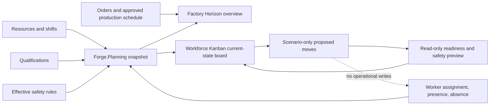

# Workforce Kanban and Supervisor Overview — Architecture Audit

Audit date: 2026-10-22

This note records the Forge implementation found before starting the workforce Kanban enhancement. The supplied consolidated prompt is treated as product requirements; it does not override repository or safety controls.

## Existing authoritative capabilities

| Concern | Existing source |
|---|---|
| Worker identity and current home/work assignment | `Forge.Workforce` and `workforce.worker` / `workforce.assignment` |
| Presence, attendance and recorded unavailability | `Forge.Workforce` attendance and presence records; current state is exposed by `/api/workforce/workers` and `/api/readiness/presence` |
| Effective home center and temporary transfers | `workforce.home_history`, `workforce.temporary_move`, and `IWorkforceLookup` |
| Qualifications | `Forge.Competency` and the qualification lookup; readiness excludes invalid or expired qualifications |
| Effective, versioned staffing/safety rules | `Forge.SafetyRules`; rules are drafted and independently published |
| Active-work safety and readiness | `OperationReadinessEngine`, `PersonnelCompositionEngine`, `ReallocationImpactEngine`, and `/api/readiness/active-work` |
| Operation-start enforcement | `OperationStartCheck` is used by the backend start workflow; the UI is not the safety boundary |
| Production schedule and approval | `planning.schedule_version` and `/api/planning/schedules/{approved,proposed}` |
| Plant status overview | Factory Horizon (`horizonPage`) already aggregates approved production, readiness, capacity, downtime, materials, orders and alerts |
| Private scenario and real-engine impact comparison | `PlanningScenarioService` stores owner-private scenarios and evaluates finite-capacity, material and recovery engines |

## Material gap

Forge has an approved production-operation schedule and a separate current worker assignment. It does **not** have an approved, effective-dated person-to-work-center roster for a week, a multi-person workforce scenario record, or an atomic workforce-schedule commit. A worker's current `workforce.assignment` is an operational fact, not a proposed schedule. Therefore a board built only from the current worker endpoint must be labelled as a current-state view; it must not claim to be a weekly approved roster.

The existing schedule approval endpoint approves production operations. It cannot safely serve as a worker-schedule commit. Calling the immediate assignment command repeatedly would risk partial commits and would bypass full-schedule revalidation, version checks and atomicity. No such shortcut will be used.

## First implementation boundary

Reuse Factory Horizon as the plant overview and add a supervisor entry to the workforce Kanban. The first board will use authorized Forge records, show source/freshness, keep proposed moves separate from current assignments, and call deterministic readiness/safety preview logic. It will not write attendance, PTO, assignments, payroll or production schedules. A backend roster model, persistence, concurrency-safe commit, approval routing and broad end-to-end coverage remain separate required work before the prompt's final acceptance criterion can be claimed.

## Data flow

## Safety invariants

1. Presence must come from current evidence; a scheduled worker is never treated as present.
2. Qualification and safety checks use the same Forge engines as other readiness paths.
3. Every cascading draft move is evaluated against one copied snapshot in sequence; a move never mutates the stored assignment.
4. A safety failure is a hard blocker in any future commit service. A UI acknowledgement cannot override it.
5. Alternative/support activities are not machine production and cannot add finished-goods output.
6. Re-enabling an operation must re-run the complete backend operation-start/readiness checks.
7. Scenario-only absence remains separate from approved attendance or leave.

## Implementation status

The first UI/read-only preview slice is implemented: a supervisor entry to Factory Horizon and a current-state Kanban
with accessible move staging, browser-session draft save/reset, scenario-only absence prefill, workforce-scoped
authorization, and sequential reallocation preview. UI coverage and planning engine tests pass. The weekly roster,
server-persisted scenarios, schedule commit and full acceptance evidence are not implemented.

## Remaining implementation phases

1. A versioned roster domain model with effective time ranges, private/shared draft scenarios, rebase and persistence.
2. Whole-schedule validation for availability, overlaps, qualifications, safety scope, approvals and production reconciliation.
3. Atomic, idempotent, concurrency-controlled roster commit with actor/scope checks, audit evidence, dependent projection refresh and notifications.
4. Integration, authorization, concurrency, touchscreen and performance coverage; then update the Claude review package with reproducible evidence.

This audit does not claim the final acceptance criterion is met.
